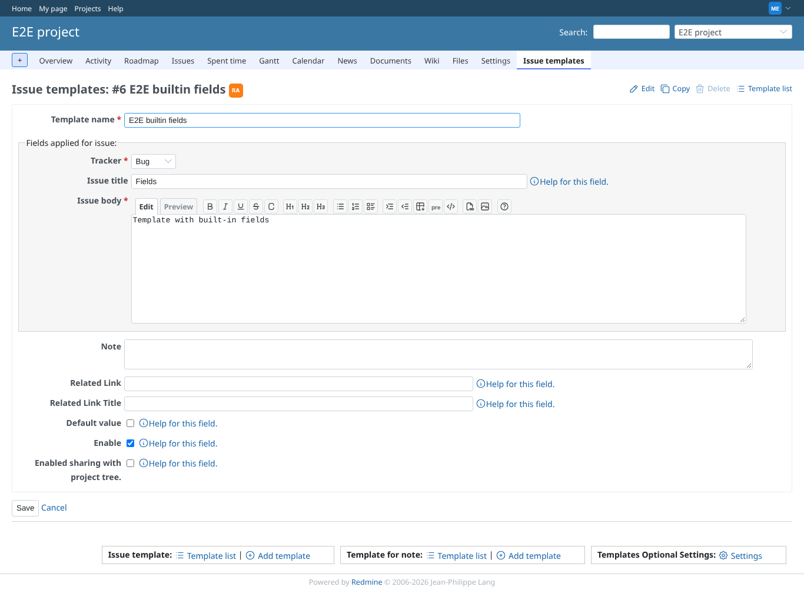
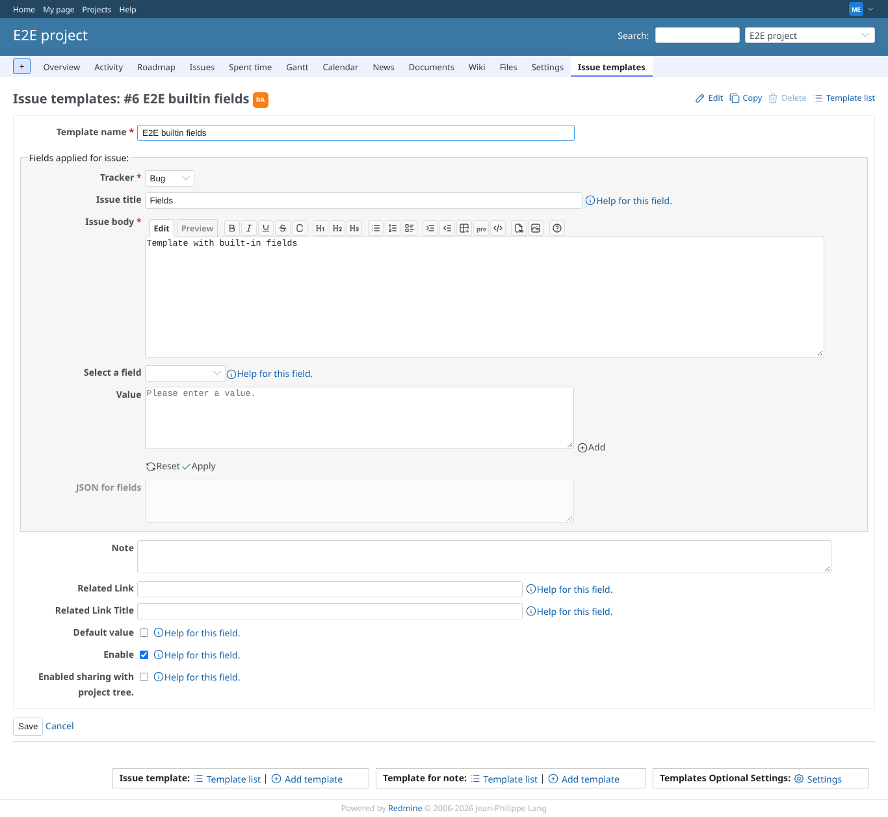
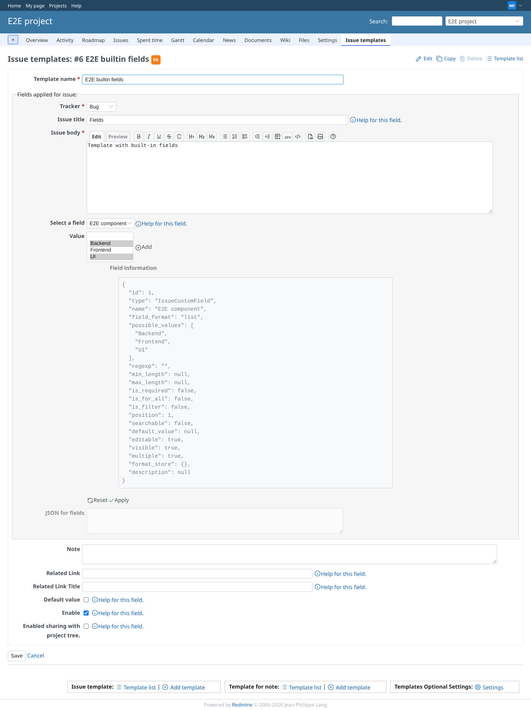
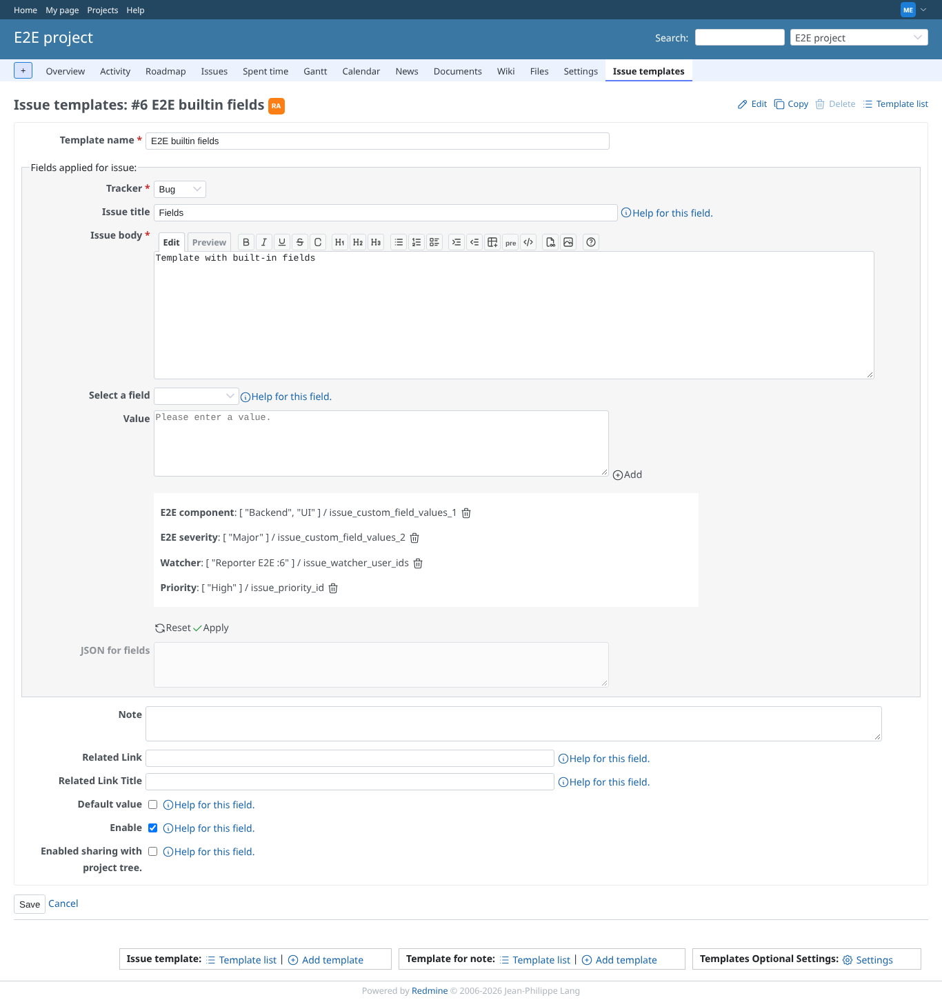
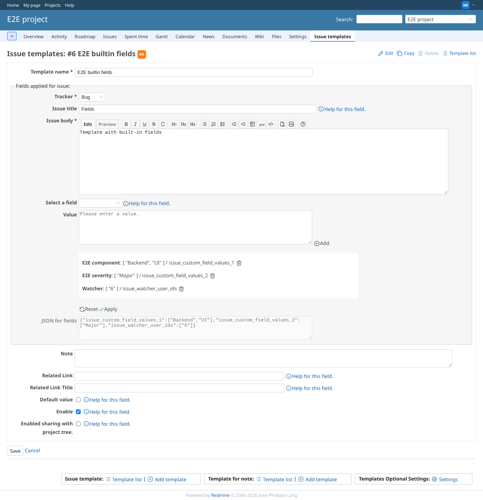
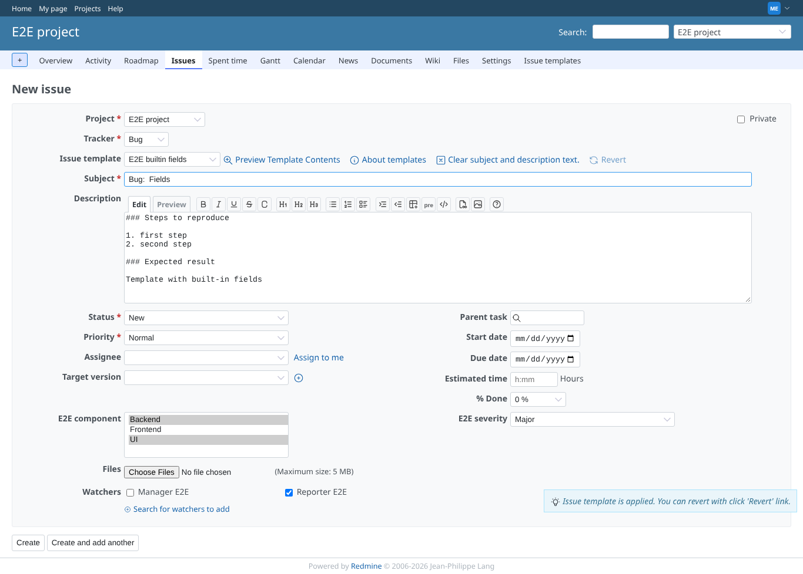
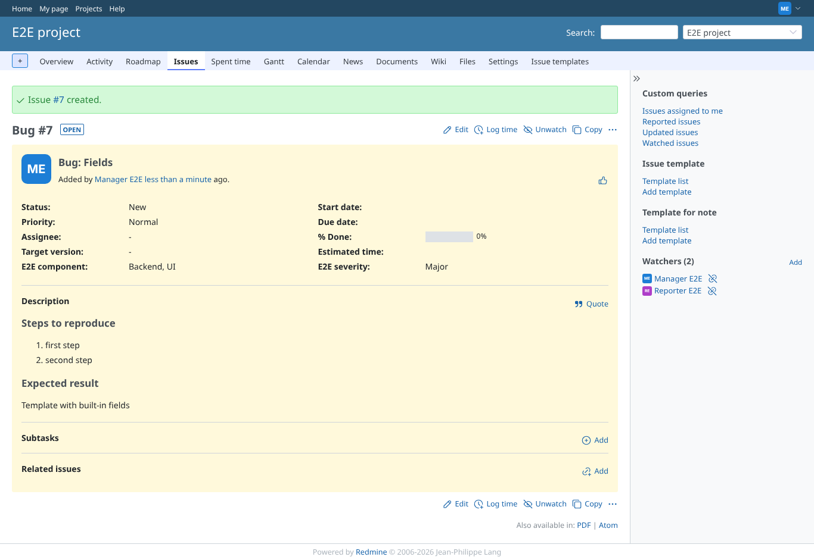
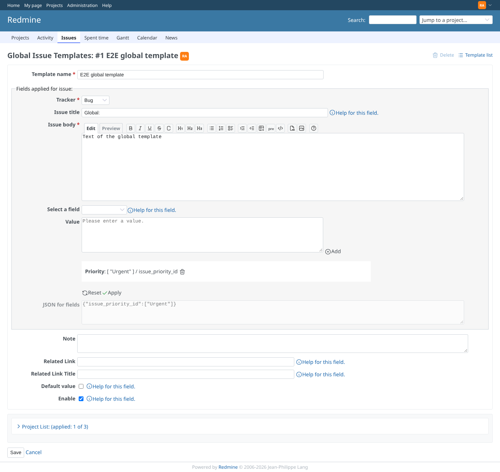
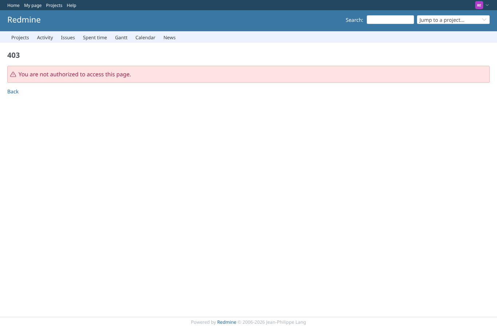
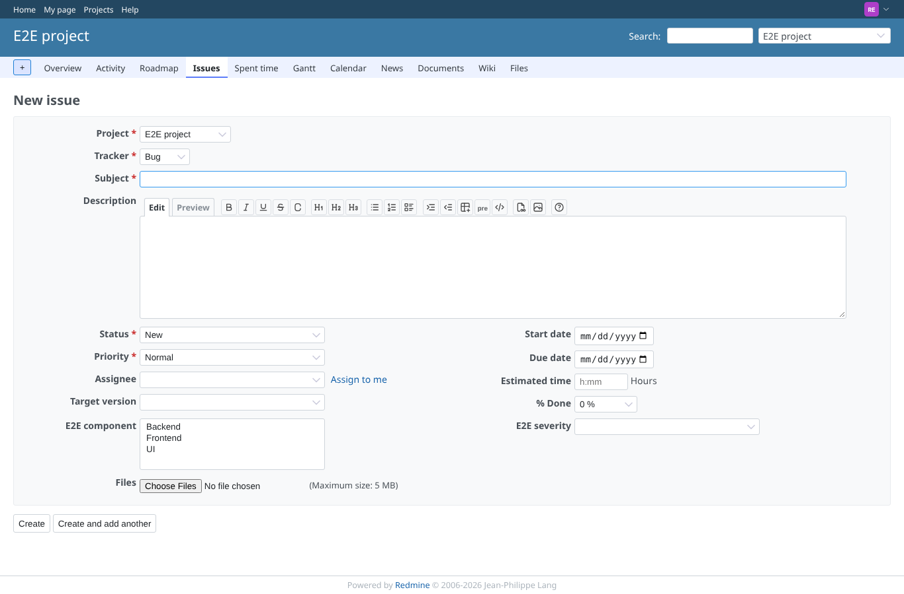

# builtin-fields

Run 2026-10-27T17:44:39.329Z against http://127.0.0.1:3000.

| screenshot | user | URL | shows |
|---|---|---|---|
|  | manager | `/projects/e2e-project/issue_templates/6` | With built-in fields off in the plugin settings the template form has no field generator |
|  | manager | `/projects/e2e-project/issue_templates/6` | The generator on a project template: field selector, value, Add, an empty list, Reset and Apply |
|  | manager | `/projects/e2e-project/issue_templates/6` | A multiple list custom field: a multiple select with its values and the field information below |
|  | manager | `/projects/e2e-project/issue_templates/6` | Four entries added: E2E component (Backend, UI), E2E severity (Major), watcher (reporter), Priority (High) |
|  | manager | `/projects/e2e-project/issue_templates/6` | Priority deleted from the list; Apply writes the three remaining entries as JSON, the watcher as its user id |
|  | manager | `/projects/e2e-project/issue_templates/6` | After saving and reopening, the saved entries are listed again; Reset drops an unsaved entry |
|  | manager | `/projects/e2e-project/issues/new` | Choosing the template on a new issue sets E2E component (Backend, UI), E2E severity (Major) and adds the reporter as a checked watcher |
|  | manager | `/issues/7` | The created issue has the custom field values and the reporter as watcher |
|  | admin | `/global_issue_templates/1` | The generator on a global template builds its JSON too (not saved) |
|  | reporter | `/projects/e2e-project/issue_templates/6` | A reporter cannot open the template with its generator (403) |
|  | reporter | `/projects/e2e-project/issues/new` | A reporter's new issue form has no template pulldown, so no built-in fields are applied |
